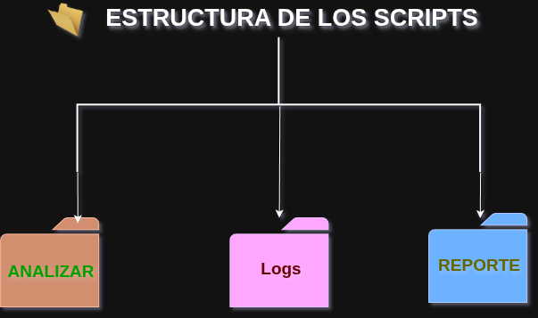
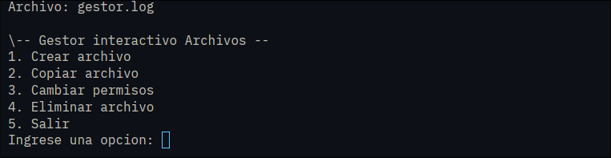
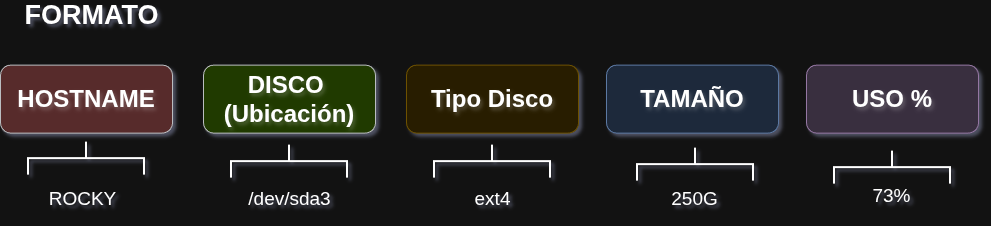
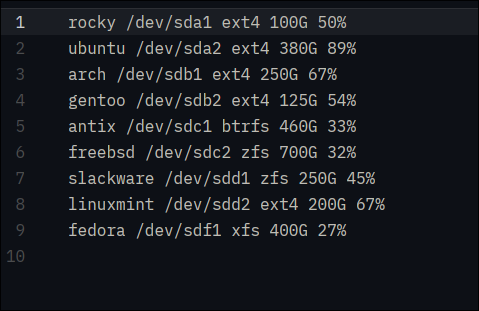
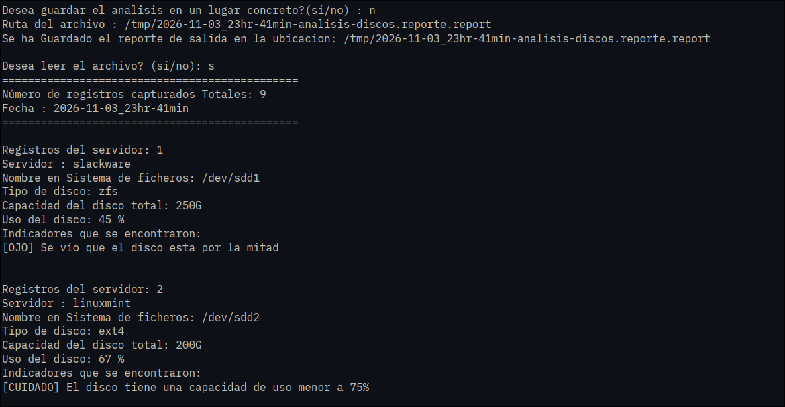
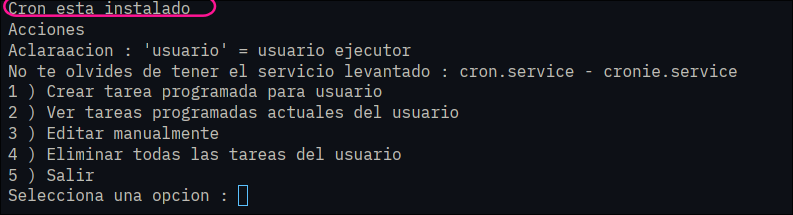

# Scripts Para gestión
Son 5 scripts que permiten ver - interactuar - analizar los discos del host donde se logra incorporar una estructura para capturar argumentos y redirecciones 
##### Estructura
Los scripts usan una estructura a esta:



Donde:
- Reporte  : Son la generación - redirecciones del stdout de la mayoria de scripts pero tienen un formato de fecha-hora y su nombre en formato **`.report`**
- Analizar : Solo `formato.sh` y `analizador_discos.sh` usan esto para analizar donde **formato.sh** genera la información que usara **analizador_discos.sh**
- Logs : Aqui se generan los eventos de formato , gestor y analizador 
###### Estructura que genera **`formato.sh`**
Ademas hay 1 adicional para ver un ejemplos dados por formato usado por el script **`formato.sh`**
## Explicación de cada script
#### 1. `sistema.sh`
```
./scripts/sistema.sh
```
Imprime y genera un reporte sobre el estado del sistema enn los siguientes aspectos.
- Información del usuario : usuario - grupos - sudo o doas - uptime
- Información del host : distro , kernel , hostname , arquitectura
- Información del disco : salida de "df -h"
- Uso de Disco : Verifica la condición del uso de disco con mensjaes sobre cada uno.

#### 2. `gestor.sh`
```
./scripts/gestor.sh
```
Es un menu interactivo para crear , copiar , eliminar y  cambiar permisos
DOnde como aclaración:
- Copiar : Se pueden copiar varios archivos o uno solo pero *no modificar el nombre de la copia*
- Eliminar : Se puede eliminar uno o varios archivos a la vez usando `rm -i` para darle doble verificación
- Permisos : Solo se puede con un archivo a la vez
- Crear : Se pueden generar varios archivos a la vez
**NOTA** : No acepta shell expansion
Cada accion genera un log en **`/logs/gestor.log`**



#### 3. `formato.sh`
```
./scripts/formato.sh
```
Genera dos archivos en base al comando **`df -hT`** 



Archivo guardado en:
+ Analizar: Este es lo necesario para otro scritp **`analizador_discos.sh`** y este cambiara y sera reemplazado
+ Reporte :  Este se mandara a reporte y sera como un bbackup del mismo ademas que su nombre tiene fecha de cuando fue creado.-



#### 4. `analizador_discos.sh`
```
./scripts/analizador_discos.sh
```
Este analiza reportes basados en la salida o generados por **`formato.sh`**. Da salida sobre cada Disco analizado del host y verifica validando con mensajes sobre el uso del mismo mandando un reporte.
Tiene un modo con argumento "automatico" para usarse con el **`tareas_programador.sh`**
- Solo acepta dos argumentos :
   1. El disco_analizar o reporte
   2. El argumento del modo
```
./scripts/analizador_discos.sh (disco_analizar) --auto
./scripts/analizador_discos.sh (disco_analizar) -a
```



#### 5. `tareas_programador.sh`
```
./scripts/tareas_programador.sh
```
Este es un menu interactivo para generar *crontabs* del usuario realizado.
**Motivo para evitar usar privilegios y priorizar tareas programadas por el usuario**
Permite :
1. Crear tarea programada
2. Ver tareas programadas
3. Editar manualmente
4. Eliminar todas las tareas del usuario
Ademas valida si esta instalado cron para poder usarse



##Autores y Colaboradores
-**Brayan Alvares Paredes** - *Desarrollo de Scrips de Bash*
-**Jhosy Dengelo Rojas Ramos** - *Desarrollo de Scrips de Bash*
